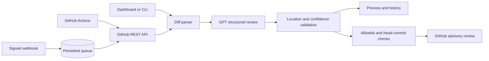

# AI Code Review Bot

[](https://github.com/Abhinav-tanwar/AI-Code-Review-Bot/actions/workflows/test.yml)

A GitHub pull request reviewer that turns code diffs into focused, severity-ranked findings. Each finding is checked against an actual added line before it can become an inline review comment.

**Built by [Abhinav Tanwar](https://github.com/Abhinav-tanwar).**


## Features

- Review a pasted unified diff or fetch an open GitHub pull request.
- Generate structured GPT findings for correctness, security, reliability, and material performance defects.
- Validate file paths and added-line locations, filter low-confidence findings, and remove duplicates.
- Inspect summaries, recommendations, model-reported confidence, and review limitations in a local dashboard.
- Export JSON reports and reopen persisted review history.
- Publish an advisory `COMMENT` review with inline findings, bound to the reviewed commit.
- Skip stale or draft PRs and reuse an existing review marker for the same head commit.
- Receive HMAC-verified webhook events through FastAPI and process a persistent local queue.
- Run automatically through GitHub Actions after explicit repository setup.

## Stack

| Component | Technology |
| --- | --- |
| Backend | Python 3.12, FastAPI, Pydantic |
| AI | OpenAI Responses API, GPT-4.1 by default |
| GitHub integration | REST API, GitHub Actions |
| Persistence | SQLite |
| Dashboard | HTML, CSS, JavaScript served by FastAPI |
| Packaging | Docker Compose |
| Verification | pytest, Ruff, GitHub Actions |

## Architecture



Repository contents are treated as data. Reviewed code is never checked out, imported, built, or executed by the review engine. Only changed lines and their surrounding patch context are sent to the model.

## Local development

Requirements: Python 3.12+ and an OpenAI API account with available credit.

```sh
git clone https://github.com/Abhinav-tanwar/AI-Code-Review-Bot.git
cd AI-Code-Review-Bot
python3 -m venv .venv
.venv/bin/python -m pip install -r requirements-dev.txt
cp .env.example .env
```

Set `OPENAI_API_KEY` privately in `.env`, then run:

```sh
.venv/bin/python -m uvicorn reviewbot.app:app --host 127.0.0.1 --port 8020
```

Open **http://127.0.0.1:8020**. The interactive API reference is at **/docs**. The macOS shortcut is **Start AI Code Review Bot.command**. Use `.venv\Scripts\python.exe` on Windows.

Choose **Load sample diff**, then **Run code review**. This invokes the real model on a synthetic payment-code fixture; it is not a prepared response. API usage is billable. A live check identified SQL injection and an empty-input division-by-zero defect, both attached to added lines.

### CLI

```sh
.venv/bin/python -m reviewbot.cli --diff examples/payment.diff
.venv/bin/python -m reviewbot.cli --repository OWNER/REPO --pull-number 42
.venv/bin/python -m reviewbot.cli --repository OWNER/REPO --pull-number 42 --publish
```

The first two commands preview only. Publication requires a GitHub token with the appropriate repository permissions and an exact `ALLOWED_REPOSITORIES` entry. `--expected-head SHA` rejects a PR that changed since the triggering event.

## GitHub Actions setup

The repository includes a test workflow and an optional PR-review workflow.

1. Add a repository Actions secret named **`OPENAI_API_KEY`**.
2. Add a repository Actions variable **`AI_REVIEW_ENABLED`** with value **`true`** to enable automatic reviews.
3. Open or update a non-draft PR from a branch in the same repository.

The workflow uses GitHub's short-lived `GITHUB_TOKEN` with `contents: read` and `pull-requests: write`; no personal access token is needed for this path. Repository or organization policies may restrict write permissions.

Automatic fork-PR review is intentionally excluded from the `pull_request` path. A maintainer can use **Actions → Automated PR review → Run workflow** on the trusted default branch, enter a PR number, and opt into publication. The bot retrieves the fork's patch as text without executing it. This also provides a manual preview before enabling automation.

The workflow checks out only the trusted default-branch implementation. Secrets are scoped to the review step. Untrusted PR fields are passed through environment variables and validated arguments, never interpolated into shell commands. Official Actions are pinned to commit SHAs.

Do not replace the trusted checkout with a PR head or merge ref in a workflow that has credentials. Avoid enabling both Actions posting and webhook auto-publication for the same repository; deduplication is best-effort rather than a distributed exactly-once guarantee.

## Optional webhook service

Configure the following backend variables:

| Variable | Purpose |
| --- | --- |
| `OPENAI_API_KEY` | Provider credential; never committed |
| `OPENAI_MODEL` | GPT model; default `gpt-4.1` |
| `GITHUB_TOKEN` | GitHub API token for private reads or publication |
| `ALLOWED_REPOSITORIES` | Comma-separated `owner/repository` values |
| `GITHUB_WEBHOOK_SECRET` | Shared secret for webhook HMAC verification |
| `AUTO_PUBLISH` | `false` by default; enable only for configured repositories |
| `API_TOKEN` | Bearer token required when accessing the API remotely |
| `ALLOWED_HOSTS` | Allowed service hostnames; defaults to loopback hosts |
| `DATA_DIR` | Optional private directory for the SQLite database |

Register an HTTPS GitHub webhook for **Pull requests** at `/webhooks/github` with the matching shared secret. Requests are authenticated against their raw body before parsing. A valid event is deduplicated by repository, PR number, and head commit, then processed from SQLite after the HTTP acknowledgment.

Run **one application worker**. Interrupted running jobs are requeued at startup. Failed jobs require an explicit retry in the dashboard and are limited to three attempts. Superseded commits are skipped. Only configured repositories can enqueue or publish reviews. The local dashboard is not a public hosting configuration: remote access requires `API_TOKEN`, an allowed hostname, and an HTTPS reverse proxy.

## Review boundaries

- Only added lines can receive findings. Deleted-only patches, binary files, unavailable GitHub patches, unsupported quoted paths, and configured generated/data/credential files are excluded.
- A review includes at most 20 files and 45,000 patch characters. Files exceeding the remaining budget are omitted whole and reported in limitations. GitHub PR fetching is capped at 100 files; larger PRs must be split.
- A model response must match the Pydantic schema. Invalid locations, confidence below 0.75, and duplicate findings are filtered. Model confidence is not a calibrated probability.
- Publication always uses `COMMENT`, never `APPROVE`, `REQUEST_CHANGES`, or merge operations. The PR head is rechecked before posting, and comments are bound to the reviewed commit.
- Findings are advisory. Location validation does not prove that an explanation is correct. Prompt injection and hallucination remain possible; review the evidence and recommendations.
- No tests from the reviewed repository are run. A result with zero findings does not establish correctness or security.
- Diff text is sent to OpenAI. Requests use `store=False`; this does not imply zero provider retention. Review results and metadata persist locally until the database is removed. The dashboard does not retain the raw pasted diff in SQLite.
- Provider and GitHub credentials stay on the backend. Local API access is restricted to loopback clients unless an API bearer token is configured. Generated comments neutralize HTML and mentions; the dashboard renders model text using `textContent`.

## Verification

```sh
.venv/bin/python -m pytest -q
.venv/bin/ruff check reviewbot tests
```

The test suite covers unified-diff edge cases, line validation, refusal handling, request limits, API authentication, cross-origin rejection, webhook signatures, allowlists, queue recovery, bounded retries, stale commits, review deduplication, missing patch coverage, and publication payloads. Automated tests use test doubles and make no paid model requests.

See [VALIDATION.md](../VALIDATION.md) for the verified test count and live integration scope.

## Docker

```sh
docker compose up --build
```

The non-root container serves the dashboard and API on **http://127.0.0.1:8020** and stores results in a named volume. For access through Docker's forwarded interface, set `API_TOKEN` and enter that application token in **Connection settings**. Do not enter your OpenAI or GitHub token into the dashboard. `.env` is provided at runtime and excluded from the image build context.

## API

| Endpoint | Purpose |
| --- | --- |
| `GET /api/health` | Configuration readiness, without exposing credentials |
| `POST /api/reviews` | Review a diff or a GitHub PR |
| `GET /api/reviews` | Recent review metadata |
| `GET /api/reviews/{id}` | Full stored review |
| `POST /api/reviews/{id}/publish` | Publish a cached PR review |
| `GET /api/jobs` | Webhook queue status |
| `POST /api/jobs/{id}/retry` | Retry an eligible failed job |
| `POST /webhooks/github` | Signed pull request events |

## References

- [OpenAI structured outputs](https://developers.openai.com/api/docs/guides/structured-outputs)
- [GitHub pull request reviews API](https://docs.github.com/en/rest/pulls/reviews)
- [GitHub Actions security](https://docs.github.com/en/actions/reference/security/securely-using-pull_request_target)
